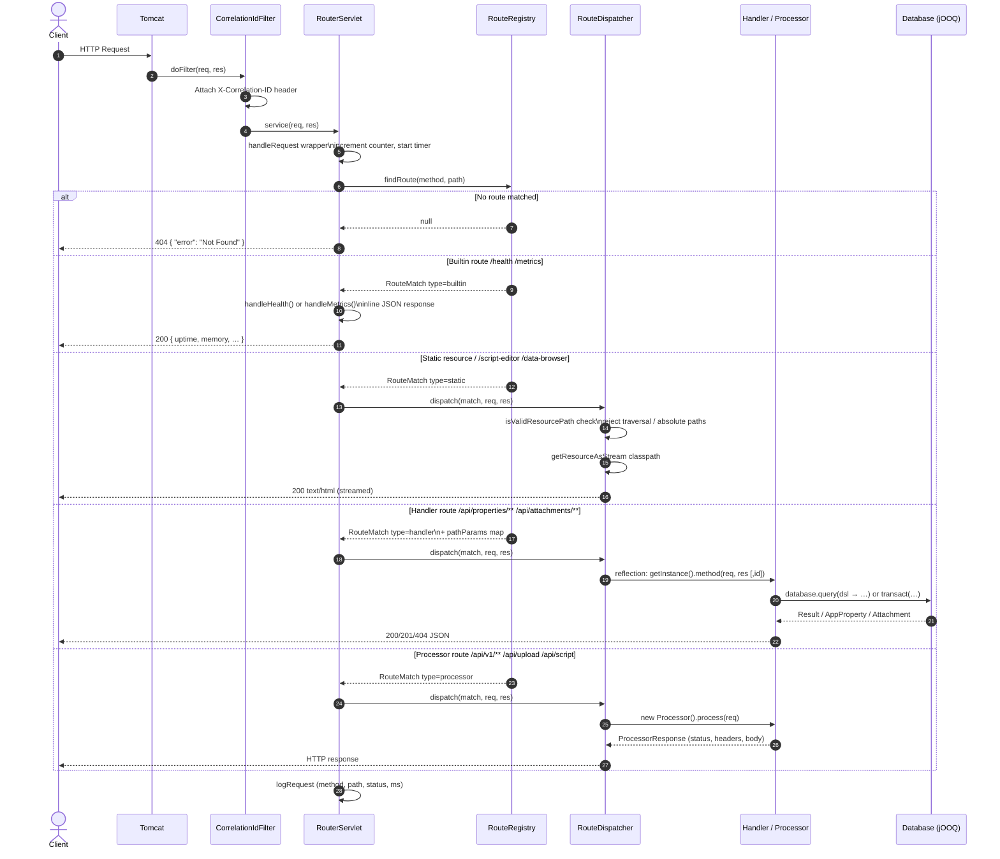

# Request Flow

How one HTTP request becomes a response.

Every request passes through the same funnel. A filter attaches a correlation
ID. `RouterServlet` wraps the call and times it. `RouteRegistry` matches method
and path. `RouteDispatcher` invokes whatever the route names.

Route type decides the rest. There are four.

## Handlers and processors differ

A handler is a singleton. `RouteDispatcher` calls `getInstance()` and invokes a
named method with the request, the response, and any path parameters. The
handler writes to the response itself.

A processor is constructed per request. It returns a `ProcessorResponse`, and
the dispatcher writes it. Processors never touch the response object.

That difference matters for downloads. A handler streaming a file owns the
output stream. A processor cannot stream, because it returns a value.

## Related

- [Startup flow](./startup-flow.md) — how routes get loaded
- [Route registry](../routing/route-registry.md) — matching and dispatch
- [Adding a route](../routing/adding-a-route.md) — picking a route type
- [Correlation IDs](../observability/correlation-ids.md) — request tracing
