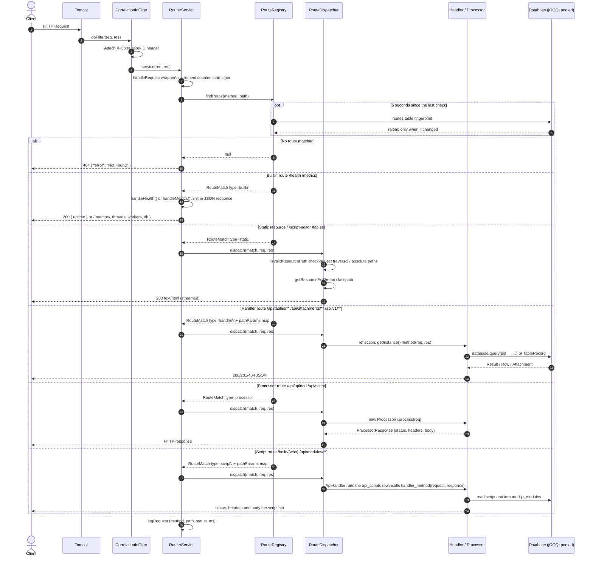

# Request Flow

How one HTTP request becomes a response.

Every request passes through the same funnel. A filter attaches a correlation
ID. `RouterServlet` wraps the call and times it. `RouteRegistry` matches method
and path. `RouteDispatcher` invokes whatever the route names.

Route type decides the rest. There are five.

## Handlers and processors differ

A handler is a singleton. `RouteDispatcher` calls `getInstance()` and invokes a
named method with the request and the response. Path parameters sit in request
attributes named `pathParam.<name>`. The handler writes to the response itself.

A processor is constructed per request. It returns a `ProcessorResponse`, and
the dispatcher writes it. Processors never touch the response object.

That difference matters for downloads. A handler streaming a file owns the
output stream. A processor cannot stream, because it returns a value.

## Script routes

A script route names an `api_scripts` row and a function in it. The dispatcher hands
both to `ApiHandler`, which runs the script in the Rhino sandbox. The function
receives a `request` object (`method`, `path`, `pathParams`, `queryParams`,
`headers`, `body`) and a `response` object. A missing function returns 500.

## Writes and business rules

A write through `TableRecord` runs the `before` rules, then the write, then the
`after` rules. A `before` rule can stop the write. Handlers, scripts and the table
browser share this path. See
[table records and rules](../scripting/table-records-and-rules.md).

## Related

- [Startup flow](./startup-flow.md) — how routes get loaded
- [Route registry](../routing/route-registry.md) — matching and dispatch
- [Table routes](../routing/table-routes.md) — the routes table and script routes
- [Adding a route](../routing/adding-a-route.md) — picking a route type
- [Correlation IDs](../observability/correlation-ids.md) — request tracing
