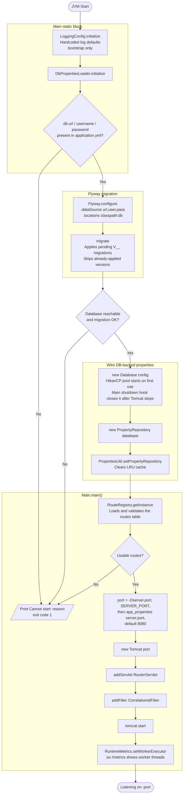

# Startup Flow

What happens between JVM start and the first accepted request.

The sequence has four stages. A static block configures logging and loads
database-backed properties. Flyway applies pending migrations. `Main` loads the
routes. Then it builds Tomcat and starts listening.

The app needs its database. Any failure before Tomcat starts ends the process with
exit code 1 and a `Cannot start:` message. There is no reduced mode.

## What stops startup

| Cause | Stage |
|---|---|
| `db.url`, `db.username` or `db.password` missing | `DbPropertiesLoader.initialize` |
| Database unreachable | Flyway, then the static block |
| A migration fails | Flyway |
| The `routes` table is unreadable, or has no usable routes | `RouteRegistry` in `Main.main` |

A route row that fails validation does not stop startup. The registry skips it and
logs the reason. Startup stops only when no route is left.

## Why routes load before Tomcat

`RouterServlet` has no load-on-startup flag, so Tomcat creates it on the first
request. Loading the registry in `Main` makes a bad table fail at start, not on the
first request. `RouterServlet.init` then picks up the loaded registry.

After startup the registry checks the table every 5 seconds. Edits go live without a
restart. See [table routes](../routing/table-routes.md).

## Why logging configures first

`LoggingConfig` runs before anything else and uses hardcoded defaults. It cannot
read properties, because properties are not loaded yet. This is bootstrap only.
Runtime log levels come from `logback.xml`.

## Related

- [Request flow](./request-flow.md) — what happens per request
- [Component responsibilities](./component-responsibilities.md) — who owns what
- [Configuration](./configuration.md) — credentials, pool size and property order
- [Properties lookup](../development/debugging.md) — cache, database, YAML order
