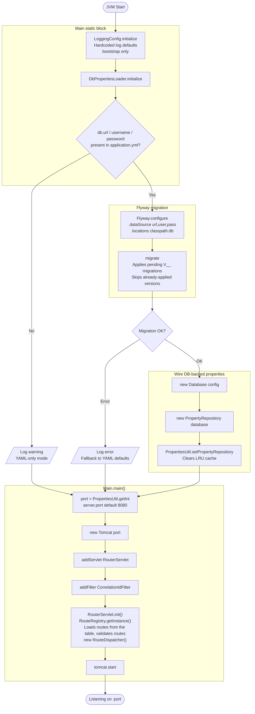

# Startup Flow

What happens between JVM start and the first accepted request.

The sequence has three stages. A static block configures logging and loads
database-backed properties. Flyway applies pending migrations. Then `Main`
builds Tomcat and starts listening.

Each stage degrades instead of failing. Missing database settings drop the app
into YAML-only mode. A failed migration falls back to YAML defaults. The server
still starts.

## Why logging configures first

`LoggingConfig` runs before anything else and uses hardcoded defaults. It cannot
read properties, because properties are not loaded yet. This is bootstrap only.
Runtime log levels come from `logback.xml`.

## Related

- [Request flow](./request-flow.md) — what happens per request
- [Component responsibilities](./component-responsibilities.md) — who owns what
- [Properties lookup](../development/debugging.md) — cache, database, YAML order
